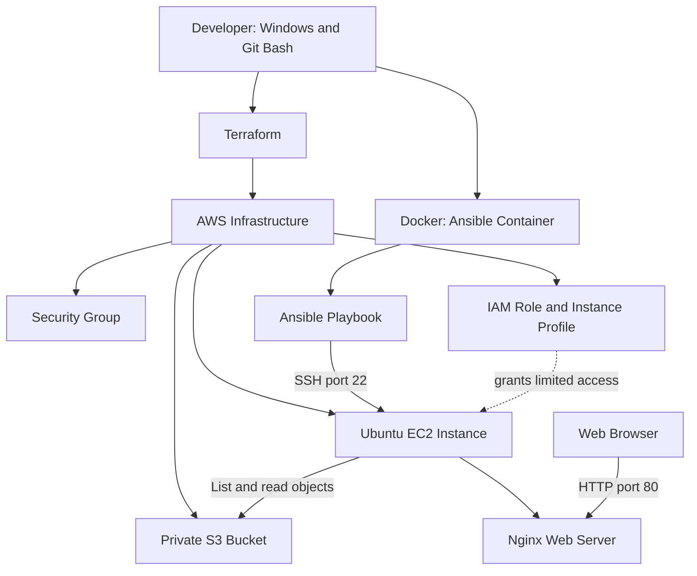

# Week 8 — Tech Challenge 3.1: Infrastructure as Code with Terraform and Ansible

## Project Overview

This project demonstrates Infrastructure as Code (IaC) on AWS using Terraform to provision cloud resources and Ansible to configure an Ubuntu EC2 web server.

The deployment installs Nginx and serves a simple Hello World webpage. An IAM role also grants the EC2 instance limited read access to a private S3 bucket.

## Architecture

- **Terraform:** Provisions the AWS infrastructure.
- **Amazon EC2:** Hosts the Ubuntu web server.
- **Amazon S3:** Provides private object storage.
- **AWS IAM:** Grants the EC2 instance least-privilege S3 read permissions.
- **Security group:** Restricts SSH access and permits HTTP traffic.
- **Docker:** Provides the Ansible execution environment.
- **Ansible:** Installs and configures Nginx and deploys the webpage.

## Architecture Diagram



Terraform provisions the infrastructure. Ansible runs in Docker and connects to EC2 over SSH to install and configure Nginx. The browser accesses the deployed webpage over HTTP. The EC2 instance uses its IAM role for restricted S3 access.

## Project Structure

```text
tech-challenge-3.1/
├── README.md
├── terraform/
│   ├── provider.tf
│   ├── variables.tf
│   ├── terraform.tfvars.example
│   ├── network.tf
│   ├── security_group.tf
│   ├── iam.tf
│   ├── main.tf
│   └── outputs.tf
└── ansible/
    ├── ansible.cfg
    ├── inventory.ini.example
    └── playbook.yml
```

## Prerequisites

- An AWS account with appropriate permissions.
- AWS CLI configured locally.
- Terraform installed.
- Docker installed and running.
- Git installed.
- An existing EC2 SSH key pair.
- Ansible available through the Docker image used for this project.

## Deployment

### 1. Configure AWS

Configure AWS CLI credentials locally using an approved method:

```bash
aws configure
aws sts get-caller-identity
```

### 2. Configure Terraform

Create a local `terraform.tfvars` file using the example configuration and supply the appropriate values for the AWS region, project name, instance type, SSH source IP and globally unique S3 bucket name.

Do not commit `terraform.tfvars`.

### 3. Provision infrastructure

```bash
cd terraform
terraform init
terraform validate
terraform plan
terraform apply
```

Review the plan before applying changes.

### 4. Configure Ansible

Update the local inventory with the EC2 public IP, Ubuntu username and the private-key path available inside the Ansible container.

Keep private keys outside the Git repository.

### 5. Run the Ansible playbook

From the project root, run the Ansible playbook using the project's configured Docker image and SSH key mount.

The playbook installs Nginx, ensures that the service is running and enabled, and deploys the Hello World HTML page.

## Docker and Ansible Execution Commands

Run these commands from the project root, `tech-challenge-3.1`.

### 1. Verify the Ansible Docker image

```bash
docker run --rm tech-challenge-3-ansible ansible --version
```

### 2. Test SSH connectivity with Ansible

```bash
MSYS_NO_PATHCONV=1 docker run --rm \
  -e ANSIBLE_HOST_KEY_CHECKING=False \
  -v "$PWD/ansible:/workspace/ansible" \
  -v tech-challenge-3-1-ssh:/keys \
  -w /workspace/ansible \
  tech-challenge-3-ansible \
  ansible -i inventory.ini webservers -m ping
```

Expected result: `SUCCESS` and `pong`.

**Security note:** Host-key checking was disabled for this training run. In production, verify the server's host-key fingerprint and keep strict host-key checking enabled.

### 3. Execute the Ansible playbook

```bash
MSYS_NO_PATHCONV=1 docker run --rm \
  -e ANSIBLE_HOST_KEY_CHECKING=False \
  -v "$PWD/ansible:/workspace/ansible" \
  -v tech-challenge-3-1-ssh:/keys \
  -w /workspace/ansible \
  tech-challenge-3-ansible \
  ansible-playbook -i inventory.ini playbook.yml
```

The playbook installs Nginx, ensures the service is running and enabled, and deploys the Hello World HTML page.

### 4. Verify the website

```bash
curl http://YOUR_EC2_PUBLIC_IP
```

Replace `YOUR_EC2_PUBLIC_IP` with the current public IP address of the EC2 instance.

### 5. Verify S3 read access from EC2

After connecting to the instance and configuring the AWS CLI to use the instance role:

```bash
aws s3api list-objects-v2 \
  --bucket YOUR_S3_BUCKET_NAME \
  --region eu-west-1
```

To verify object-read permissions, download an existing test object using `aws s3 cp`.

The Ansible Docker image and SSH-key volume must already exist for the commands above to work.

## Build the Ansible Docker Image

From the project root, build the image:

```bash
docker build -t tech-challenge-3-1-ansible ./ansible
```

Verify the installation:

```bash
docker run --rm tech-challenge-3-1-ansible ansible --version
```

The Dockerfile installs Python, Ansible and SSH utilities required to execute the playbook against the remote Ubuntu EC2 instance.

## Verification

The following checks were completed during the project:

- Terraform successfully provisioned the AWS infrastructure.
- Ansible connected to the EC2 instance and completed the playbook with zero failures.
- The Hello World webpage was accessible over HTTP.
- S3 public access block settings were enabled.
- The EC2 instance profile was associated with the intended IAM role.
- The IAM role successfully listed the S3 bucket and downloaded a test object.

## Security Considerations

- Restrict SSH access to an authorised IP address.
- Keep S3 Block Public Access enabled.
- Use an IAM role instead of long-lived AWS credentials on EC2.
- Grant only the S3 permissions required by the workload.
- Verify SSH host keys in production; do not routinely disable host-key checking.
- Never commit private keys, AWS credentials, Terraform state files, or sensitive plan files.

## Cleanup

When the infrastructure is no longer needed, review the resources and run:

```bash
cd terraform
terraform plan -destroy
terraform destroy
```

Confirm that the resources can safely be removed before approving destruction. Back up any required data first.

## Learning Outcomes

This project demonstrates practical experience with Terraform, AWS infrastructure provisioning, IAM roles, S3 access control, Docker, Ansible, Linux administration, Nginx deployment and infrastructure troubleshooting.

## Deployment Evidence

### Hello World Webpage


### Ansible Playbook Execution


## CI/CD Pipeline with Jenkins

### Overview

This project uses Jenkins to automate code checkout and validation whenever changes are pushed to the GitHub repository. The pipeline checks the Terraform infrastructure configuration and Ansible playbook before any deployment is considered.

**Repository:** [Tech-challenge-3.1](https://github.com/ibukunolu7-cloud/Tech-challenge-3.1)

### Pipeline Architecture

The CI workflow consists of the following components:

- **GitHub:** Hosts the project source code and tracks changes on the `main` branch.
- **Jenkins:** Retrieves the repository and orchestrates the validation stages.
- **Jenkins validator agent:** A dedicated Docker-based agent named `tech-challenge-3-1-validator`, configured with the `terraform-ansible` label.
- **Terraform:** Validates the infrastructure-as-code configuration and provider dependencies.
- **Ansible:** Checks the playbook syntax used to configure the web server.

### Automatic Build Trigger

Jenkins is configured to use **Poll SCM** to check the GitHub repository for new commits.

Polling schedule:

```text
H/5 * * * *
```

This schedules repository checks approximately every five minutes. When Jenkins detects a new commit, it automatically starts the pipeline without requiring a manual build.

### Validation Stages

The Jenkins pipeline executes the following stages:

1. **Checkout:** Retrieves the latest source code from GitHub.
2. **Check Project Files:** Verifies that required Terraform, Ansible, and documentation files are present.
3. **Check Tool Versions:** Confirms that Terraform and Ansible are available on the validator agent.
4. **Terraform Format Check:** Runs `terraform fmt -check -recursive terraform` to check formatting without modifying files.
5. **Terraform Initialize:** Runs `terraform -chdir=terraform init -backend=false -input=false` to initialize the configuration and provider dependencies without configuring a backend.
6. **Terraform Validate:** Runs `terraform -chdir=terraform validate` to check the Terraform configuration.
7. **Ansible Syntax Check:** Runs `ansible-playbook --syntax-check playbook.yml` using a temporary local inventory to validate the playbook syntax without executing its tasks.

### Successful CI Test

The pipeline was tested successfully following a GitHub push.

| Item | Result |
|---|---|
| Repository branch | `main` |
| Test commit | `7e1922a` |
| Trigger | SCM change detected by Jenkins |
| Build status | SUCCESS |
| Terraform formatting | Passed |
| Terraform initialization | Passed |
| Terraform validation | Passed |
| Ansible syntax check | Passed |

The successful Jenkins console output confirmed:

```text
Started by an SCM change
All required project files are present.
Success! The configuration is valid.
playbook: playbook.yml
All Terraform and Ansible validation checks passed.
Finished: SUCCESS
```

### Scope and Safety

This pipeline is a **validation-only CI workflow**. It does not execute `terraform apply`, `terraform destroy`, or the Ansible playbook against the EC2 server. Therefore, a successful build confirms that the automated checks passed; it does not confirm that infrastructure deployment or server configuration has taken place.

### Skills Demonstrated

- Git and GitHub version control
- Jenkins Declarative Pipeline
- Automated CI using SCM polling
- Docker-based Jenkins agent configuration
- Terraform formatting, initialization, and validation
- Ansible playbook syntax validation
- Automated validation and build-result monitoring


